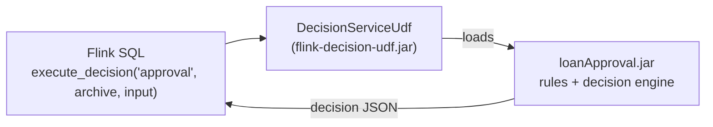

# Calling an IBM Decision Intelligence decision service from Flink SQL

This sample runs an IBM Decision Intelligence **decision service** from an Apache Flink SQL query.
A scalar function, `DecisionServiceUdf`, loads the decision service and runs it for each row.

```sql
SELECT
  application,
  execute_decision(
    'approval',                                            -- operation to run
    'file:///opt/flink/decision-service/loanApproval.jar', -- decision service archive
    JSON_OBJECT('loan' VALUE ..., 'borrower' VALUE ...)    -- decision input, as JSON
  ) AS decision_json                                       -- decision output, as JSON
FROM loan_applications;
```

The decision service is the **Loan Approval** sample of Decision Intelligence. It decides whether to
approve a loan from the loan and the borrower. The SQL in [`sql/loan-approval.sql`](sql/loan-approval.sql)
sends two applications and prints the decisions:

| application | approved | message |
|---|---|---|
| small loan, low score | `true` | Congratulations! Your loan has been approved |
| large loan, high score | `false` | Too big Debt/Income ratio: 0.3943594113786697 |

## How it works



- A **decision service archive** (`loanApproval.jar`) is a JAR with compiled rules and the decision engine.
  It is built by Decision Designer. Nothing is deployed to a server: the rules run **inside the Flink task**.
- `DecisionServiceUdf` opens the archive from the URI in the SQL call, finds the requested operation, and runs it.
  The archive is loaded once per operation and archive URI, then reused for every row.
- The UDF JAR contains only the UDF, the decision API (`engine-de-api`) and Jackson. It does not contain the decision service.
- If a call fails, the result is `{"error":"..."}` and the job keeps running. The stack trace is in the TaskManager log.

## Prerequisites

| | |
|---|---|
| JDK 21+ and Maven 3.9+ | to build |
| Docker with Compose v2 | to run Flink |
| Access to the Decision Intelligence Maven repository | to download `com.ibm.decision:engine-de-api`, see below |

`engine-de-api` (the decision API, interfaces only) is **not on Maven Central**. It is published in the Maven repository that
Decision Intelligence provides, the same one the [IBM samples](https://github.com/icp4a/automation-decision-services-samples)
use ([documentation](https://www.ibm.com/docs/en/dicms/26.0.0?topic=environment-using-decision-designer-as-maven-repository)).
If your `~/.m2/settings.xml` already gives access to it, skip this step. Otherwise:

```bash
cp settings.example.xml settings.xml
# edit settings.xml: set the repository URL and your Zen API key
```

and add `-s settings.xml` to the `mvn` command below. `settings.xml` is ignored by git.

## Run it

```bash
# 1. Build. This runs the tests, downloads the Loan Approval archive, and builds the UDF JAR.
mvn package                     # or: mvn -s settings.xml package

# 2. Start Flink 2.2.0 (one JobManager, one TaskManager)
docker compose up -d

# 3. Run the SQL
docker compose exec -T jobmanager /opt/flink/bin/sql-client.sh -f /opt/flink/sql/loan-approval.sql

# 4. Stop Flink
docker compose down
```

> If your shell sets `MAVEN_ARGS=-DskipTests`, the tests are skipped. Run `MAVEN_ARGS= mvn package` to run them.

`mvn package` creates the two files that Flink needs:

| File | Content | Mounted in the containers at |
|---|---|---|
| `target/udf/flink-decision-udf.jar` | `DecisionServiceUdf` (about 3 MB) | `/opt/flink/udfs/` |
| `target/decision-service/loanApproval.jar` | the Loan Approval decision service | `/opt/flink/decision-service/` |

The archive is downloaded from the public
[icp4a/automation-decision-services-samples](https://github.com/icp4a/automation-decision-services-samples)
repository, at a pinned commit and checked against a SHA-256 (see `decision.service.*` in [`pom.xml`](pom.xml)).

## Result

Step 3 prints:

```
+------------------------+----------+-----------------------------------------------+------------------------------------------------------------------------------------------------------+
|            application | approved |                                       message |                                                                                        decision_json |
+------------------------+----------+-----------------------------------------------+------------------------------------------------------------------------------------------------------+
|  small loan, low score |     true |  Congratulations! Your loan has been approved |    {"approval":{"approved":true,"message":"Congratulations! Your loan has been approved"},"insurance":{"rate":0.006,"required":true}} |
| large loan, high score |    false | Too big Debt/Income ratio: 0.3943594113786697 | {"approval":{"approved":false,"message":"Too big Debt/Income ratio: 0.3943594113786697"},"insurance":{"rate":0.0025,"required":true}} |
+------------------------+----------+-----------------------------------------------+------------------------------------------------------------------------------------------------------+
2 rows in set
```

(Column widths vary slightly.) `decision_json` is what the decision service returns: the `approval` decision and the `insurance` rate.
The query reads fields from it with `JSON_VALUE`. The UDF logs `Loaded decision operation 'approval' ...` in the TaskManager the first time it runs:

```bash
docker compose logs taskmanager | grep DecisionServiceUdf
```

## Use your own decision service

1. Build a decision service archive in Decision Designer (or take one from the samples repository's `archives/` directory).
2. Make it available at the same path in every TaskManager (a mounted volume, or an `http:`/`https:` URL).
3. Call it with the name of an operation it declares (`META-INF/decisions/*.json`, field `operationName`) and an input matching that operation's input model:

```sql
SELECT execute_decision('<operation>', '<archive URI>', '<input JSON>') FROM ...
```

## Function reference

```
execute_decision(operationName STRING, archiveUri STRING, inputJson STRING) -> STRING
```

| Argument | |
|---|---|
| `operationName` | operation to run, as declared in the archive |
| `archiveUri` | `file:`, `http:` or `https:` URI of the decision service archive |
| `inputJson` | decision input as JSON. Build it with `JSON_OBJECT(...)` |

Returns the decision output as JSON, or `{"error":"<message>"}`. A `NULL` argument returns an error.
Unknown properties in the input are ignored by the decision service, so a misspelled field does not fail: it stays unset.

## Troubleshooting

| Symptom | Cause and fix |
|---|---|
| `Could not find artifact com.ibm.decision:engine-de-api` | The Decision Intelligence Maven repository is not configured. See [Prerequisites](#prerequisites). |
| `{"error":"Operation '...' not found in decision service archive ..."}` | The operation name is wrong, or the archive file does not exist **on the TaskManager** (`docker compose exec taskmanager ls /opt/flink/decision-service`). |
| `{"error":"Cannot deserialize ..."}` | The input JSON does not match the operation's input model. |
| `ClassNotFoundException: com.ibm.di.flink.udf.DecisionServiceUdf` | The UDF JAR is not at the `USING JAR` path. Run `mvn package` **before** `docker compose up`. |
| `UnsupportedClassVersionError` in the TaskManager | The archive was built for a newer Java than the Flink image provides. Use a Flink image with that Java version. |

## Limits

- Validated with Flink 2.2.0 (`flink:2.2.0-scala_2.12-java21`), Java 21 and `engine-de-api` 3.12.0. Newer decision service
  archives may need a newer `engine-de-api` (`engine.de.api.version` in the POM), and possibly a newer Java.
- The sample runs a bounded query on inline rows to stay self-contained. The function is an ordinary scalar function and can be
  used in a streaming query, but that is not shown here.
- Archives are loaded once and kept until the function is closed. They are not reloaded when the file changes.
- Decision services that call a machine-learning service need extra runtime configuration that this sample does not provide.

## Project layout

```
pom.xml                  build: tests, archive download, UDF JAR
settings.example.xml     Maven settings template for the Decision Intelligence repository
docker-compose.yml       Flink 2.2.0 JobManager and TaskManager
sql/loan-approval.sql    the Flink SQL example
src/main/java/...        DecisionServiceUdf
src/test/java/...        tests that run the Loan Approval archive
```

## License

[Apache License 2.0](LICENSE). The Loan Approval archive and `engine-de-api` are IBM software and are
subject to their own license terms.
